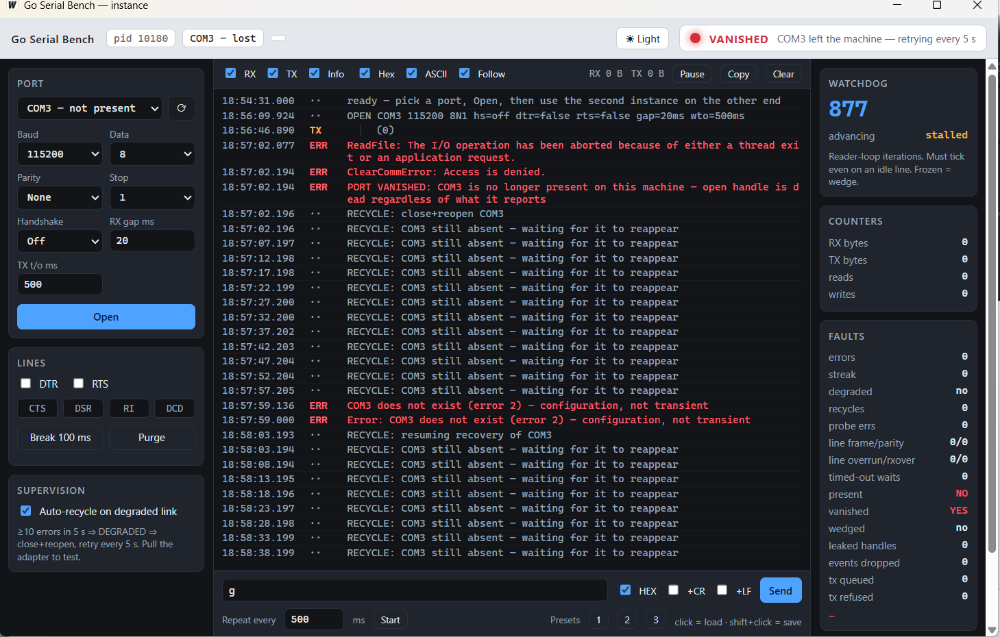
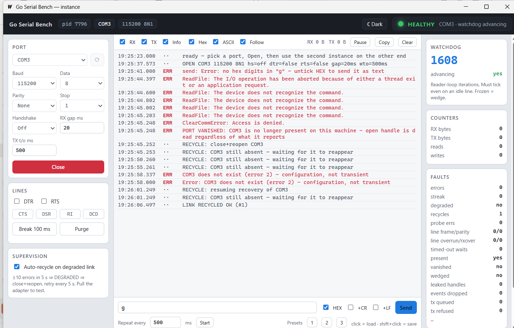

# Go Serial Bench

A free serial-port monitor for Windows, for hardware engineers who need to see
the actual bytes on a COM port — and need the tool to still be there after the
adapter is unplugged.

One executable. No installer, no runtime, no cgo, no driver. The UI is a local
web page in a WebView2 window; everything from the UART up is Go.



*The adapter was physically unplugged mid-session. The port is classified as
vanished within milliseconds, the watchdog stalls rather than resetting, and
recovery retries on its own — including after a manual connect attempt failed.*



*The same session in light theme after recovery: `RECYCLE: resuming recovery`
then `LINK RECYCLED OK`. Switch themes with the button in the title bar.*

## What it does

- **Hex and ASCII side by side**, per chunk, with byte counts and timestamps.
- **Send** raw text or hex (`01 03 00 00 00 02 C4 0B`), with optional CR/LF, a
  repeat timer, and three saved presets.
- **DTR / RTS control** and live **CTS / DSR / RI / DCD** indicators.
- **Break** and **purge** levers.
- **Line-error counters** — framing, parity, overrun, RX-overflow, break —
  read from `ClearCommError`. Without these, a line corrupting every byte
  looks exactly like a quiet one.
- **Light and dark themes**, toggled from the button in the title bar. Text
  contrast is recomputed from the actual surface brightness rather than
  assumed, so the monitor stays readable on a bright bench or in a dim lab.
- **Run two instances** on two ports to watch both ends of a link at once.

## Why another one

Most of the work here is not the hex view. It is staying alive when the
hardware misbehaves, which on Windows is harder than it looks:

- **Unplugging a USB adapter does not hang it.** Serial timeouts are enforced
  by the driver; once the device is gone, nothing enforces them, and the
  ordinary blocking wait on an overlapped read never returns. Every wait here
  has its own deadline, so removal is detected rather than survived.
- **It tells you the port vanished**, authoritatively, by checking whether the
  port still exists on the machine — not by guessing from an error code.
  Error codes on removal are not stable: the same adapter family has produced
  `995 → 5 → 2` in about 30 ms on one pull and a stream of error 22 on
  another. Behaviour is classified; codes are only labels.
- **It reconnects by itself** when the adapter comes back, retrying every 5 s,
  and keeps retrying even if a manual connect attempt fails in between.
- **The window never blocks on the serial port.** Status is served from
  memory, connects happen without holding a lock, and writes are queued — an
  8 KiB write at 9600 baud legitimately takes 9.4 seconds, which is not
  something a UI thread should sit inside.
- **A watchdog counts reader-loop iterations, including idle ones.** A counter
  that only moves when data arrives cannot be told from a wedged one on a
  quiet line. It stalls across an outage rather than resetting, because a
  reset reads as "the program restarted".
- **A handle that cannot be proved idle is leaked and counted, never closed.**
  Windows reuses handle values; closing one while a thread is still inside a
  syscall on it lets the next connect inherit the same value and read another
  port's bytes. A leaked handle is a number on screen. A recycled one is
  silent cross-talk that looks like a device fault.

There is deliberately **no "healthy" flag inside the port layer**. The port
counts; the supervisor decides. A component that grades itself is trusting the
thing that may be broken.

## Install

Download `serial_terminal.exe` from
[Releases](../../releases) and run it. Windows 10/11 with the WebView2 runtime,
which ships with Windows 11 and current Windows 10.

It is not code-signed, so SmartScreen will warn on first run.

## Build from source

Requires [Go](https://go.dev) 1.25+ and [Wails v2](https://wails.io).

```bash
go install github.com/wailsapp/wails/v2/cmd/wails@latest
cd serial_terminal
wails build          # -> build/bin/serial_terminal.exe
wails dev            # hot-reload development
```

## Use it

1. Pick a port, set baud/parity/stop/handshake, press **Open**.
2. Watch RX/TX in the monitor. **Pause**, **Copy** and **Clear** are in the
   toolbar; the RX/TX/Info and Hex/ASCII checkboxes filter the view live.
3. The right rail is facts only — watchdog, counters, faults. `present`,
   `vanished` and `wedged` are what to read when something goes wrong.
4. Leave **Auto-recycle** ticked to have it recover from a replug on its own.

> **DTR and RTS are destructive on many dev boards.** On ESP32 and similar,
> they are wired to reset and boot-select, so asserting them reboots the
> target or drops it into its bootloader. Both default to **off** here for
> exactly that reason.

## The library

`serialkit/` is a standalone Go module with no dependency on the GUI — only
`golang.org/x/sys`. Copy the folder and use it.

```go
p, err := winserial.Open(winserial.Config{
    Name: "COM3", Baud: 115200, DataBits: 8, Parity: "none", StopBits: "1",
    ReadGapMs: 20, WriteTimeoutMs: 500,
}, func(b []byte) { /* received */ }, func(e error) { /* failed */ })
```

| package | what it holds |
| --- | --- |
| `serialkit/winserial` | the Win32 port: open, read, write, modem lines, line errors, counters |
| `serialkit/supervisor` | policy: health, degradation, bounded auto-recovery, event rate limiting |

`winserial` is mechanism and holds no opinions. `supervisor` is policy and
knows nothing about any UI — it reports through a `Sink`, so the same policy
drives a GUI, a CLI, a service or a test unchanged.

## Command-line tools

```bash
go run ./serialkit/cmd/hwprobe COM3      # identify a port: sweep bauds,
                                         # read modem lines, report line errors
go run ./serialkit/cmd/hwreset COM3      # pulse reset on an ESP32-class board
                                         # and capture its boot banner
```

`hwprobe` writes nothing and never asserts DTR/RTS, so it is safe to point at
a board that is running.

## Tests

```bash
go test -race ./serialkit/...
```

Tests that need hardware skip themselves when it is absent. Some use a
[com0com](https://sourceforge.net/projects/com0com/) virtual pair on
COM11/COM12 for loopback; a virtual pair cannot simulate a device actually
vanishing, so removal behaviour has to be checked with a real adapter.

`-race` is not optional here: a data race in the reader goroutine shows up in
the field as an occasional wrong reading rather than as a crash.

## Known limits

- **Windows only.** The port layer is Win32; the supervisor is portable in
  shape but not in build tags.
- **The leak-instead-of-close path has never been observed firing.** It exists
  because closing an in-use handle is unsafe, but on every adapter tested the
  driver honoured its timeouts and cancellation worked.
- **No hardware flow control has been verified end to end.** It can be
  configured, and a deasserted CTS correctly stalls a write and returns it on
  deadline, but no board with CTS actually wired has been tested.
- Soak evidence is minutes, not hours.

## Licence

MIT — see [LICENSE](LICENSE).
